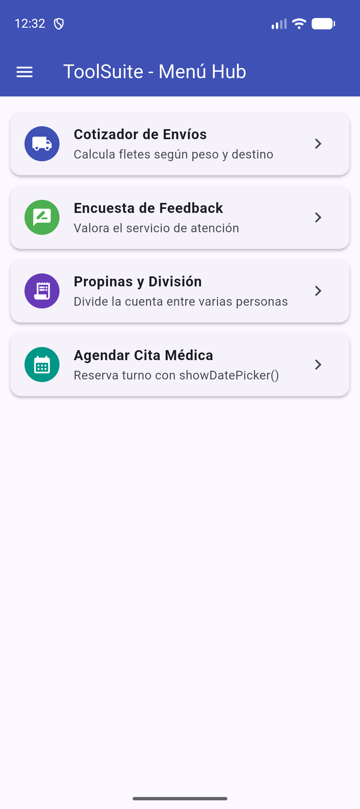
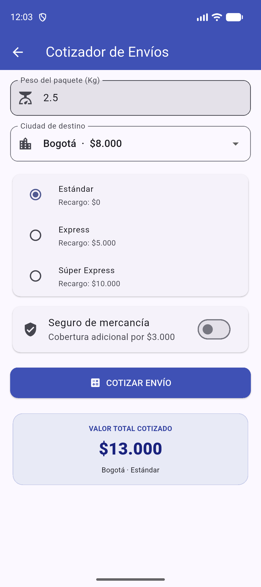
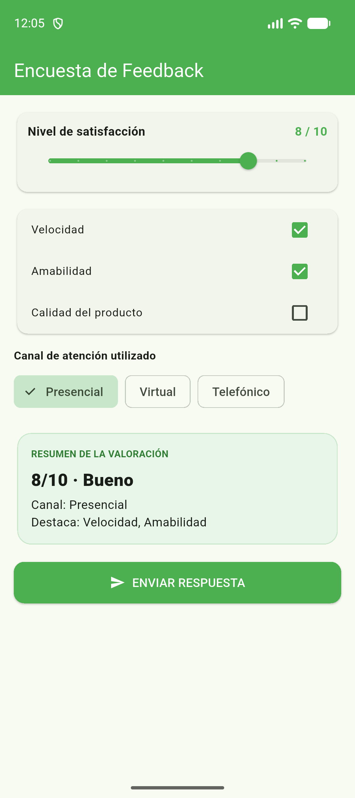
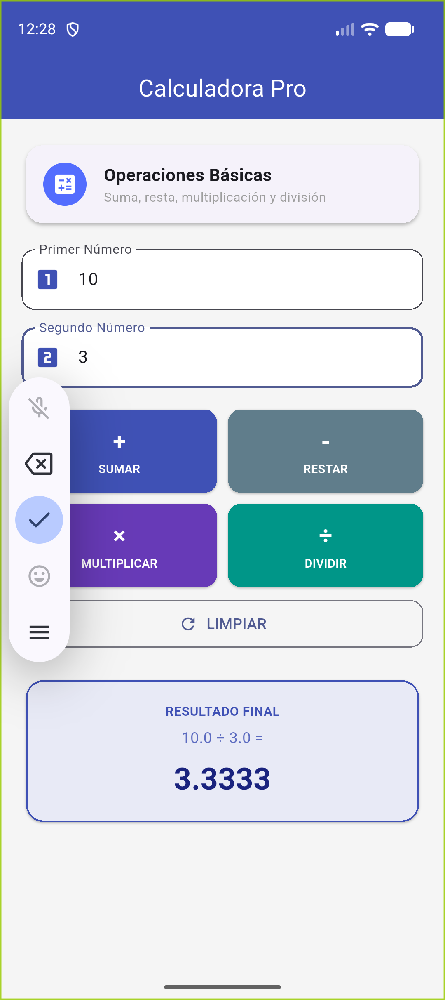

# ToolSuite — Ejercicios de Desarrollo Móvil con Flutter

Proyecto del curso de desarrollo móvil: una aplicación integradora que reúne varios
ejercicios de UI en un solo menú navegable, más dos apps independientes y las guías
interactivas de clase.

El objetivo pedagógico es pasar de *"todo el código en `main.dart`"* a una
**arquitectura multi-archivo** con modelos POO, pantallas separadas y navegación
con `Navigator`.



---

## Qué contiene

| Carpeta / archivo | Descripción |
|---|---|
| **`flutter_application_1/`** | **ToolSuite** — app integradora: menú hub con `ListView.builder`, `Drawer` y `Navigator.push()` hacia cada ejercicio |
| **`calculadora_app/`** | Proyecto independiente — Calculadora con las 4 operaciones (+, −, ×, ÷) |
| **`encuesta_app/`** | Proyecto independiente — Encuesta de satisfacción |
| `clase_2_*.html` | Guía interactiva: anatomía de widgets, Flex Engine, laboratorios visuales y 4 retos con simulador |
| `clase_3_*.html` | Guía interactiva: navegación, POO, arquitectura `lib/` y reto integrador |

Las guías HTML se abren directamente en el navegador, sin servidor ni dependencias.

---

## La ToolSuite

El menú no usa `if/else` ni `switch` para decidir a dónde navegar. Cada ítem es un
objeto `Herramienta` que **guarda dentro su pantalla destino**, y el
`ListView.builder` la instancia sola:

```dart
Herramienta(
  id: '1',
  titulo: 'Cotizador de Envíos',
  descripcion: 'Calcula fletes según peso y destino',
  icono: Icons.local_shipping,
  color: Colors.indigo,
  pantallaDestino: const CotizadorScreen(),  // ← una pantalla es un objeto
),
```

```dart
onTap: () => Navigator.push(
  context,
  MaterialPageRoute(builder: (context) => item.pantallaDestino),
),
```

Si mañana agregas 20 herramientas más, el código del menú **no cambia**: solo crece
la lista. Eso es lo que hace valioso el modelo de datos.

### Estructura

```
flutter_application_1/lib/
├── main.dart                     → MaterialApp + MenuScreen
├── models/
│   ├── herramienta.dart          → modelo POO de cada tarjeta del menú
│   └── medico.dart               → modelo del reto integrador
└── screens/
    ├── menu_screen.dart          → hub con Drawer y ListView.builder
    ├── cotizador_screen.dart     → Dropdown · RadioListTile · SwitchListTile
    ├── encuesta_screen.dart      → Slider · CheckboxListTile · ChoiceChip
    ├── propina_screen.dart       → SegmentedButton · IconButton
    └── citas_screen.dart         → showDatePicker() · ChoiceChip
```

### Los ejercicios

| Pantalla | Qué resuelve | Widgets que practica |
|---|---|---|
| **Cotizador de Envíos** | Calcula el flete según peso, ciudad, velocidad del servicio y seguro opcional | `TextField`, `DropdownButtonFormField`, `RadioListTile`, `SwitchListTile` |
| **Encuesta de Feedback** | Califica un servicio y arma un resumen en tiempo real | `Slider`, `CheckboxListTile`, `ChoiceChip`, `SnackBar` |
| **Propinas y División** | Divide la cuenta de un restaurante entre varias personas | `SegmentedButton`, `IconButton` |
| **Agendar Cita Médica** | Reserva un turno y genera un ticket de confirmación | `showDatePicker()` asíncrono, `ChoiceChip` |

<p align="center">
  
  
</p>

---

## Apps independientes

Los dos ejercicios centrales de la Clase 2 también viven como proyectos Flutter
completos, para poder ejecutarlos por separado:

- **`calculadora_app/`** — suma, resta, multiplicación y división. Valida campos
  vacíos, atrapa la división entre cero y recorta los decimales infinitos
  (`10 ÷ 3` → `3.3333`, no `3.3333333333333335`).
- **`encuesta_app/`** — la encuesta con su `Slider`, casillas y chips.

<p align="center">
  
</p>

---

## Cómo ejecutar

Requiere **Flutter 3.44** o superior.

```bash
git clone https://github.com/nicolneira07-tech/flutter-toolsuite.git
cd flutter-toolsuite/flutter_application_1   # o calculadora_app / encuesta_app

flutter pub get
flutter run
```

## Pruebas

Los tres proyectos tienen pruebas de widget y pasan `flutter analyze` sin avisos:

```bash
flutter analyze
flutter test
```

| Proyecto | Pruebas | Qué verifican |
|---|---|---|
| `flutter_application_1` | 3 | El hub lista sus herramientas, cada una abre y regresa con `pop`, el drawer se abre |
| `calculadora_app` | 7 | Las 4 operaciones, división entre cero, campos vacíos y limpiar |
| `encuesta_app` | 3 | Estado inicial, cambio de canal y `SnackBar` al enviar |

---

## Notas técnicas

Escrito contra **Flutter 3.44 / Dart 3.12**, usando el API vigente:

- `RadioListTile` va dentro de un widget `RadioGroup` ancestro
  (`groupValue` y `onChanged` en el tile quedaron obsoletos).
- `DropdownButtonFormField` usa `initialValue` en lugar de `value`.

El material HTML de clase muestra la forma clásica, que sigue compilando pero
genera avisos de deprecación en versiones recientes.
